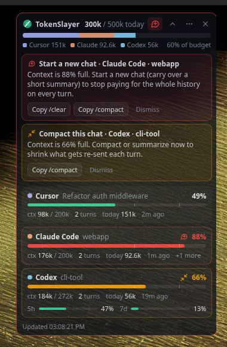
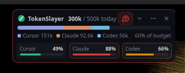

# TokenSlayer

A small always-on-top overlay for Windows that shows how many tokens you are burning in **Cursor**,
**Claude Code** and **Codex**. It also flags the chat that should be **compacted** or replaced
with a **new chat** before a long context history keeps eating your quota.

 

## What it shows

- **Global bar**: tokens used today across all three tools, stacked by tool, against a daily budget
  you choose (`dailyTokenBudget`, default 5M). Cache reads are left out by default because they are
  cheap and run into tens of millions in agent sessions. Set `includeCacheReads: true` to count them.
- **Per-tool card**:
  - how full the active chat's context window is, with tick marks at the compact and new-chat
    thresholds
  - the turn count and today's tokens for that tool
  - plan or rate-limit bars when the vendor reports them (Claude 5h / 7d, Codex 5h / 7d, Cursor plan %).
- **Alert icon** in the header:
  - amber "compress" icon: a chat passed `compactAtPercent` (60%)
  - red "new chat" icon: a chat passed `newChatAtPercent` (85%).

  Click the icon to see which chat it is, with one-click copy buttons for the right command
  (`/compact`, `/clear`, `/new`, `/summarize`). You also get a Windows toast notification each time
  a chat crosses a threshold. Compacting re-arms the alert, and **Dismiss** silences it until
  the chat gets worse.
- **Collapsed mode** (chevron button) shrinks it to a one-line bar with a mini context gauge per tool.

The tray icon changes color with the worst alert (green, amber, red) and its tooltip has a summary.

## Install

1. Download `TokenSlayer-<version>-portable.exe` (no install) or `TokenSlayer Setup <version>.exe`
   from the **build** workflow artifacts in GitHub Actions, or build it yourself (see below).
2. Run it. The overlay appears in the top-right corner, and a tray icon gives you the menu.

| Action | How |
| --- | --- |
| Move | drag the header |
| Show / hide | `Ctrl+Alt+T`, tray icon click, or the × button |
| Click-through (lock so it never steals clicks) | `Ctrl+Alt+K` or tray menu |
| Settings | tray menu → *Open config file*, then *Reload config* |
| Start with Windows | tray menu checkbox |

## Where the numbers come from

Everything is read locally and read-only. Nothing is modified in any IDE.

| Tool | Source | Context % | Today's tokens | Limits |
| --- | --- | --- | --- | --- |
| Claude Code (CLI and the IDE extensions) | `%USERPROFILE%\.claude\projects\**\*.jsonl` (also `CLAUDE_CONFIG_DIR`, `~/.config/claude`) | exact: last main-thread request's input + cache + output tokens over a 200k window (1M once a session goes past 200k) | sum of `message.usage`, deduped by message/request id | `api.anthropic.com/api/oauth/usage` using Claude Code's own OAuth login (`.credentials.json`) |
| Codex (CLI and IDE extension) | `%USERPROFILE%\.codex\sessions\**\*.jsonl` (or `CODEX_HOME`) | exact: `last_token_usage` over `model_context_window`, with the same 12k baseline the Codex TUI uses | deltas of the cumulative `total_token_usage` | `rate_limits` recorded in the session log (no network) |
| Cursor | `%APPDATA%\Cursor\User\globalStorage\state.vscdb` (SQLite, opened read-only) | from Cursor's context-window fields or the last reply's `tokenCount` when present; otherwise **estimated** from chat text length (shown with `~`) | cursor.com usage events when signed in, otherwise local `tokenCount`s | cursor.com `usage-summary` (falls back to the legacy request counter) |

Files are tailed incrementally: each poll (every 10 s) only reads bytes appended since the last one.

### Network calls

There are only two, and you can turn both off in the config (`network.cursorApi`,
`network.claudeUsageApi`). Both reuse a login you already have and only talk to the vendor's own
domain, at most once every 3 minutes:

- **Cursor**: reads the session token Cursor stores in `state.vscdb` and calls `cursor.com`
  dashboard endpoints (`/api/usage-summary`, `/api/dashboard/get-filtered-usage-events`).
- **Claude**: reads `~/.claude/.credentials.json` and calls `api.anthropic.com/api/oauth/usage`
  (the endpoint behind Claude Code's `/usage`). It never refreshes tokens. If the token has expired,
  it waits until Claude Code refreshes it.

These endpoints and Cursor's local schema are undocumented and can change. When something fails,
the overlay keeps working with local data and lists the problem in the footer tooltip.

## Configuration

`%APPDATA%\TokenSlayer\config.json` is created on first run. You can also point to another file
with the `TOKENSLAYER_CONFIG` environment variable.

```jsonc
{
  "dailyTokenBudget": 5000000,     // 0 = just show the total
  "includeCacheReads": false,
  "compactAtPercent": 60,
  "newChatAtPercent": 85,
  "activeChatMaxAgeMinutes": 180,  // chats idle longer than this are ignored
  "pollIntervalSeconds": 10,
  "notifications": true,
  "providers": { "cursor": true, "claude": true, "codex": true },
  "network": { "cursorApi": true, "claudeUsageApi": true, "intervalSeconds": 180 },
  "contextWindows": { "claude": 0, "codex": 0, "cursor": 200000 },  // 0 = auto
  "paths": {
    "claudeDirs": [],              // e.g. ["C:\\Users\\me\\.claude", "\\\\wsl$\\Ubuntu\\home\\me\\.claude"]
    "codexHome": "",
    "cursorStateDb": ""
  },
  "overlay": { "x": null, "y": null, "width": 340, "opacity": 0.94, "expanded": true,
               "clickThrough": false, "showUndetected": false,
               "toggleShortcut": "Control+Alt+T", "clickThroughShortcut": "Control+Alt+K" }
}
```

If you run Claude Code or Codex inside WSL, add the WSL paths in `paths` (as in the example above).

## Development

Requires Node 22.13+ (the app uses the built-in `node:sqlite`, so there are no native modules).

```bash
npm install
npm test            # unit + integration tests against generated sample data
npm run typecheck
npm run demo        # launches the overlay with generated sample data (no IDE needed)
npm run probe       # prints what the collectors see on this machine as JSON
npm run start       # launches the overlay against your real data
npm run dist:win    # builds the NSIS installer + portable exe into release/
```

Layout: `src/core` holds the collectors and logic (no Electron, fully unit-tested), `src/main` is
the Electron main process (window, tray, notifications), and `src/renderer` is the overlay UI.
